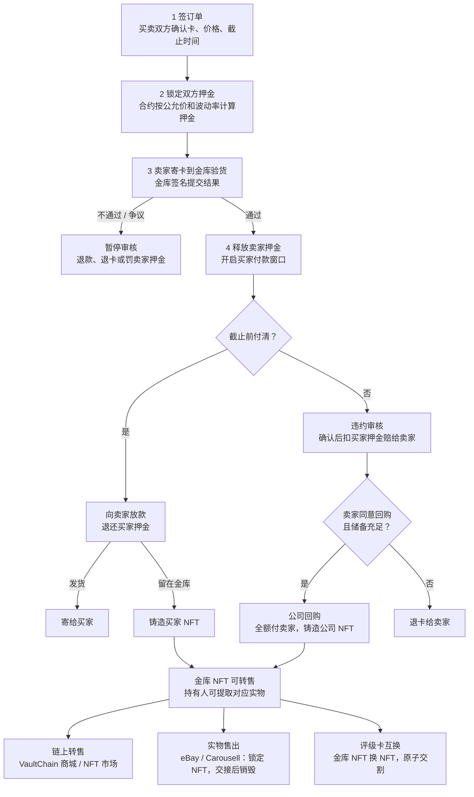
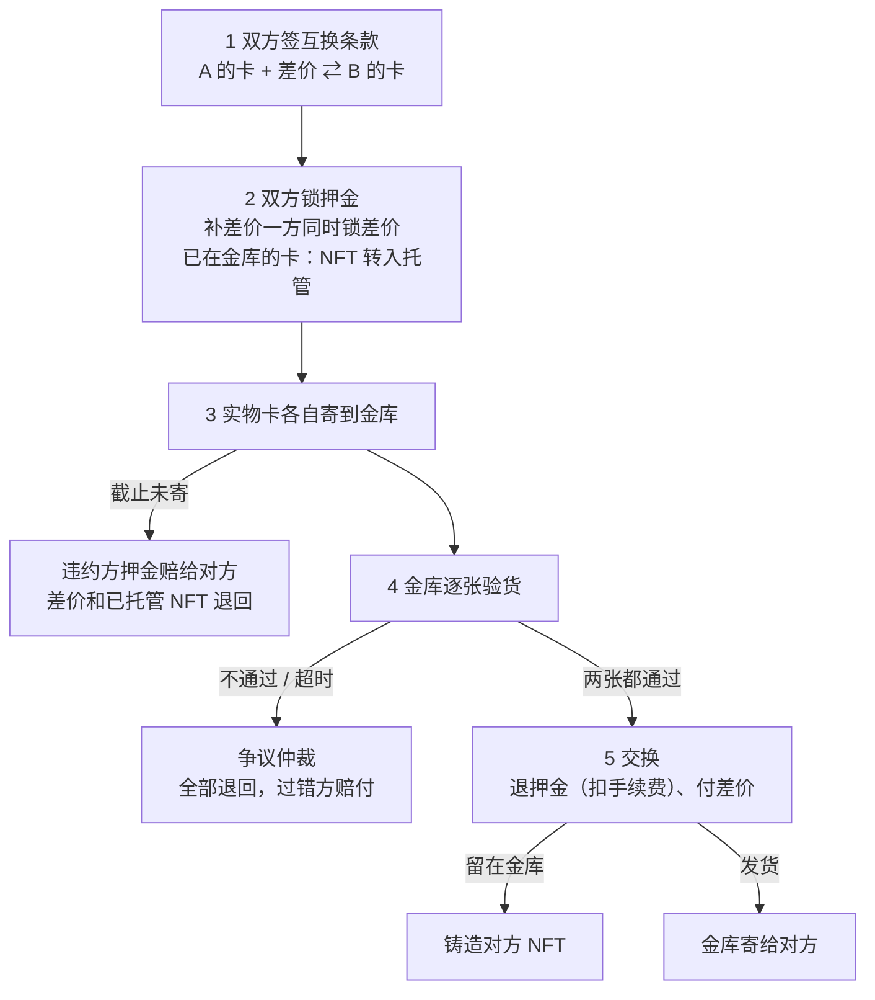
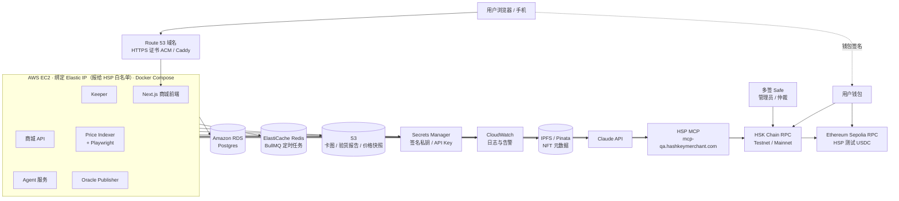
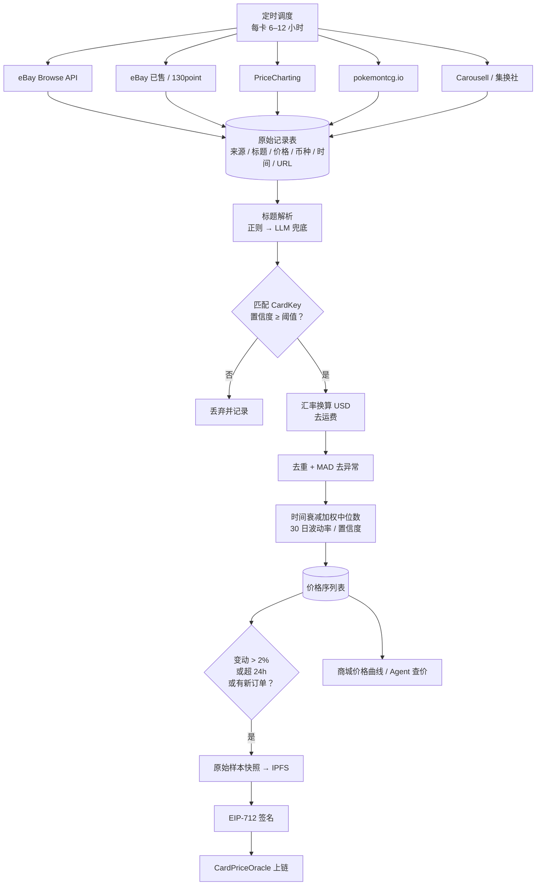
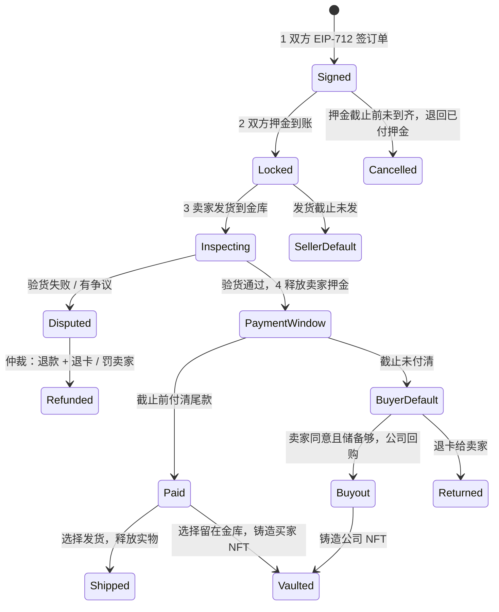
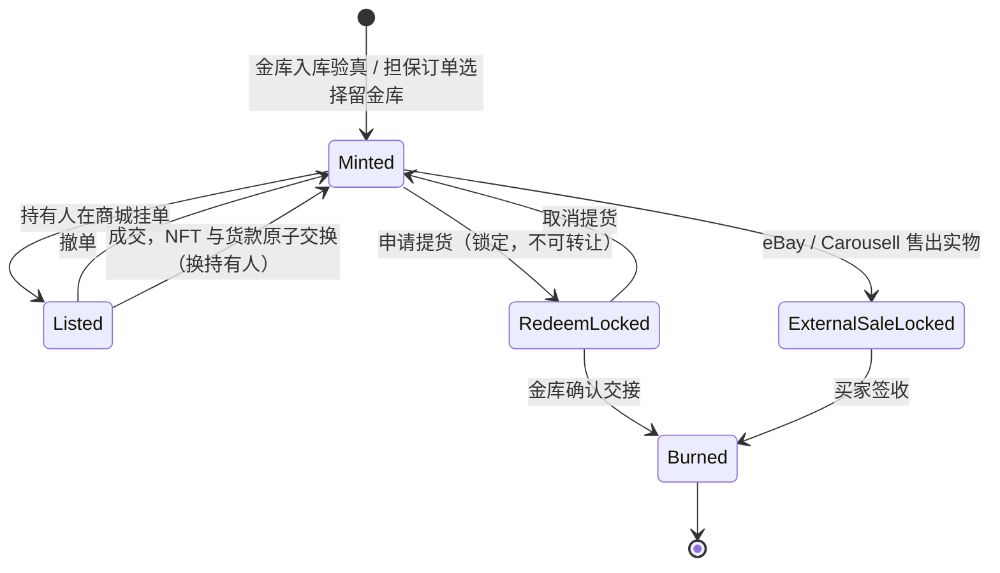
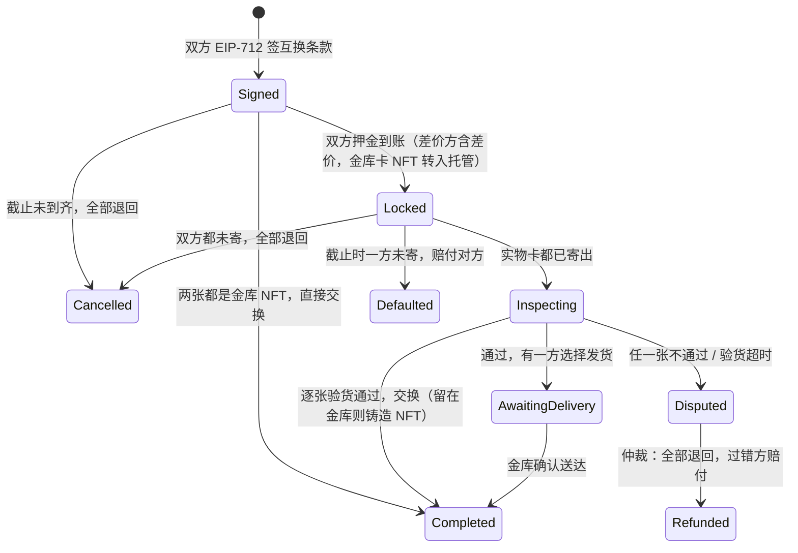
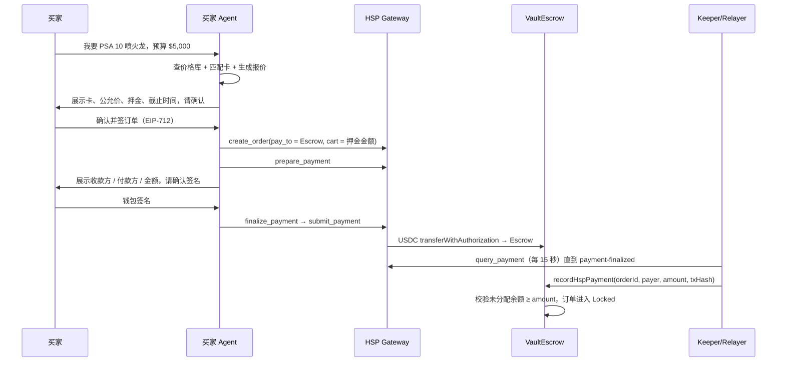
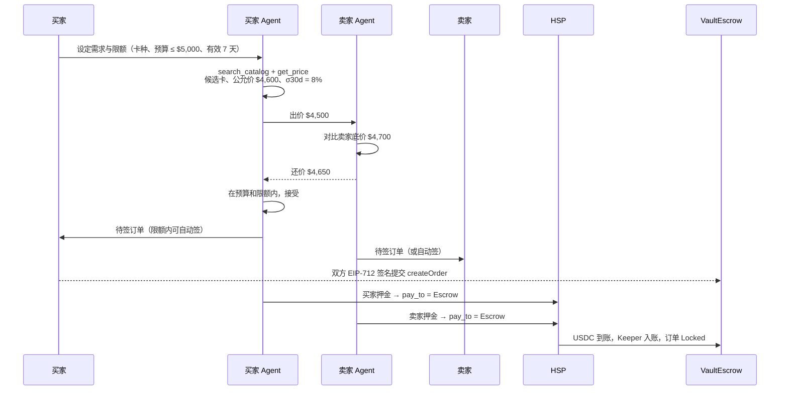
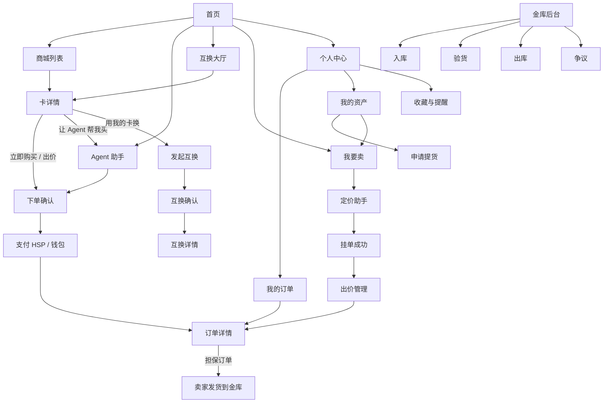

# VaultChain 技术方案

> 版本 v0.2 · 2026-11-26（v0.2：加入评级卡互换 Swap；明确第一版不做裸卡评级）
> 目标：在 HSK Chain Horizon Hackathon（Seoul）**Agent Payments & A2A Settlement** 赛道提交可运行的 Demo，同时作为正式产品的第一版架构。
> 提交截止：**2026-12-03 12:00 SGT**；Demo Day 12-05；进入 Demo 的队伍须把合约部署到 **HSK Chain 主网**。
> **第一版范围**：只做已评级卡（PSA / BGS / CGC），**不做裸卡送评**。交易方式两种：**买卖**（USDC 买卡）和**评级卡互换**（例如 PSA 10 换 PSA 10，可补差价）。

---

## 1. 背景与要解决的问题

高价唯一卡牌（PSA / BGS / CGC 评级卡）现在主要在 eBay、Carousell、集换社等平台成交，有三个问题：

1. **无理由退款带来的价格风险**：卡价波动时，买家在下跌时退款，卖家在上涨时拒发货，平台规则保护不了另一方。
2. **重复运输与鉴定成本**：同一张卡反复转手，每次都要寄送和验真。
3. **价格不透明**：成交价分散在不同平台、不同币种，缺乏统一可信的参考价。

**VaultChain 的解法**：

- 买卖双方在链上签订单，**各自锁定押金**，智能合约按规则结算，不能无理由退款，违约方的押金赔给守约方。
- 支持**评级卡互换（Swap）**：双方用卡换卡（如 PSA 10 皮卡丘换 PSA 10 喷火龙），价值不等时一方补 USDC 差价。同样双边押金，一方反悔就赔另一方。
- 卡寄到合作金库，验货结果由金库签名上链。
- 留在金库的卡铸造成唯一 NFT（绑定评级证书号和图像哈希），之后转卖 NFT 即可，提货时锁定并销毁。
- 从 eBay 等平台持续采集成交价，生成**链上价格预言机**，用来定押金比例、校验订单价格、计算违约赔偿。
- 买家 AI Agent 负责找卡、比价、出价，并通过 **HSP（HashKey Settlement Platform）** 完成 Agent 支付。

### 业务全流程



### 评级卡互换流程（Swap）

两张卡都已在金库（都是 NFT）时，一笔交易原子互换，不需要押金。只要有一张还是实物，就走带押金的担保互换：



竞品对比：

| | Renaiss | 集换社 | VaultChain |
|---|---|---|---|
| 核心模式 | 抽卡（Gacha）+ 金库 + 90% 回购 | 中心化平台担保交易 | 链上双边押金担保 + 金库 NFT |
| 交易方式 | 抽卡、回购 | 买卖 | 买卖 + 评级卡互换（可补差价） |
| 履约保障 | 平台规则 | 平台客服仲裁 | 合约强制执行，违约赔付自动结算 |
| 价格参考 | 平台定价 | 平台内成交 | 多平台成交价聚合，签名上链 |
| AI Agent | 无 | 无 | 买家 Agent 匹配、出价、HSP 支付 |

---

## 2. 总体架构

<div class="arch"><div class="al" style="--c:#E8B84A"><div class="at">用户层</div><div class="ar"><div class="ab"><b>卡牌商城前端</b><span>Next.js · 买家 / 卖家</span></div><div class="ab"><b>金库后台</b><span>入库 / 验货 / 出库 / 争议</span></div><div class="ab"><b>用户钱包</b><span>MetaMask / OKX Agentic Wallet</span></div></div></div><div class="aa">▼ 浏览、下单、出价、钱包签名、验货签名</div><div class="al" style="--c:#5B8DEF"><div class="at">应用服务层</div><div class="ar"><div class="ab"><b>商城 API</b><span>商品 / 挂单 / 出价 / 订单索引</span></div><div class="ab"><b>买家 / 卖家 Agent</b><span>Claude 工具调用 · A2A 议价</span></div><div class="ab"><b>Keeper</b><span>HSP 支付对账 · 截止时间触发</span></div></div></div><div class="aa">▼ 查价找卡 · 调用 HSP 支付 · 证书核验</div><div class="al" style="--c:#3FA37A"><div class="at">数据与外部服务层</div><div class="ar"><div class="ab"><b>Price Indexer</b><span>采集 → 归一 → 去异常 → 聚合</span></div><div class="ab"><b>Postgres</b><span>成交记录 / 价格序列 / 订单</span></div><div class="ab"><b>Oracle Publisher</b><span>EIP-712 签名价格</span></div><div class="ab"><b>外部价格源</b><span>eBay / PriceCharting / pokemontcg / Carousell / 集换社</span></div><div class="ab"><b>HSP Gateway</b><span>x402 Agent 支付（MCP）</span></div><div class="ab"><b>PSA API</b><span>证书核验</span></div></div></div><div class="aa">▼ 签名价格上链 · HSP 把 USDC 直接转入托管合约 · Keeper 入账结算</div><div class="al" style="--c:#1d1d1f"><div class="at">链上合约层（HSK Chain）</div><div class="ar"><div class="ab"><b>CardPriceOracle</b><span>公允价 / 波动率 / 证据哈希</span></div><div class="ab"><b>VaultEscrow</b><span>买卖订单 / 押金 / 违约结算</span></div><div class="ab"><b>SwapEscrow · VaultSwap</b><span>评级卡互换 / 补差价</span></div><div class="ab"><b>VaultCardNFT · VaultMarket</b><span>金库卡 NFT / 现货买卖</span></div></div></div><div class="aa up">▲ 合约事件同步到商城 API（订单状态、NFT 归属）</div></div>

| 模块 | 技术选型 |
|---|---|
| 合约 | Solidity 0.8.x，Foundry（开发、测试、部署），OpenZeppelin |
| 链 | 开发：HSK Chain Testnet + Ethereum Sepolia（HSP QA 的测试 USDC 在 Sepolia）；Demo：HSK Chain Mainnet |
| 后端 | Node.js 24 + TypeScript，Fastify，viem，Playwright（爬虫），BullMQ + Redis（定时任务） |
| 数据库 | Postgres（成交记录、价格序列、订单索引） |
| AI Agent | Claude（`claude-sonnet-5-5`）工具调用；HSP 通过官方 MCP（`hsp-agentic-payment`）接入 |
| 前端 | Next.js + Tailwind + wagmi/viem + RainbowKit，黑金配色（与 logo 一致） |
| 存储 | 卡图和元数据放 IPFS（Pinata），链上只存 CID 和哈希 |

### 2.1 部署架构



说明：
- **服务器用 AWS**。所有服务打包成 Docker 镜像，用 Docker Compose 跑在一台 EC2 上（比赛期间 `t3.large` 足够；Playwright 爬虫比较吃内存）。
- HSP 要求 IP 白名单，所以 EC2 要**绑定 Elastic IP**，作为固定的公网出口 IP 报给 HSP。不能用 Lambda、Vercel 之类出口 IP 不固定的平台。
- 比赛期间 Postgres 和 Redis 也可以先作为容器跑在同一台 EC2 上省钱，正式上线再迁到 RDS 和 ElastiCache；代码只依赖连接字符串，不用改。
- Oracle 签名私钥和 Relayer 私钥放 Secrets Manager，不写进镜像和代码仓库。
- 区域建议选新加坡 `ap-southeast-1`，离 HSK Chain 节点和目标用户都近。

---

## 3. 卡价采集与价格预言机（重点）

卡价是押金比例、订单价格校验和违约赔偿的依据，所以单独设计成一个服务。

### 3.1 数据源

| 数据源 | 获取方式 | 拿到的数据 | 稳定性 / 合规 | 比赛期间 |
|---|---|---|---|---|
| **eBay Browse API** | 官方 REST API（需 eBay 开发者账号，OAuth client credentials） | 在售挂单价格、标题、图片、卖家 | 官方，稳定 | ✅ 主力 |
| **eBay 已售成交** | ① Marketplace Insights API（需 eBay 单独审批，周期不确定）② 130point.com（聚合了 eBay 成交含“接受议价”的实际价）③ eBay 已售列表页爬虫 | 最近 90 天成交价 | ②③ 是爬虫，eBay 用户协议禁止自动抓取，会遇到反爬 | ⚠️ 低频抓取 + 缓存，演示用 |
| **PriceCharting API** | 付费 API key | 按评级（PSA 10/9、BGS 9.5 …）分档的价格和历史 | 稳定，覆盖评级卡 | ✅ 推荐 |
| **pokemontcg.io** | 免费 API key | TCGplayer、Cardmarket 的裸卡市场价 | 稳定 | ✅ 裸卡参考 |
| **PSA Public API** | 免费 token（每日限额） | 证书号 → 卡名、年份、评级（**用于验真**，不是价格） | 官方 | ✅ 入库验证 |
| **Carousell（新加坡）** | Playwright 爬虫 | 在售挂单价（SGD） | 无公开 API，结构常变 | 可选 |
| **集换社 / SNKRDUNK** | 爬虫 | 中国 / 日本市场价 | 同上 | 可选，正式版再做 |
| **汇率** | 汇率 API（如 open.er-api.com） | USD / SGD / CNY / JPY | 稳定 | ✅ |

**合规原则**：优先用官方 API。爬虫模块单独开关，遵守 robots.txt，低频（每张卡每 6–12 小时一次），只抓公开页面，不登录、不绕过验证码；正式上线前，eBay 成交数据要换成官方 Marketplace Insights API 或付费数据商。

### 3.2 数据处理流程



### 3.3 卡片身份归一（CardKey）

各个平台上的标题写法都不统一，所以先给每张卡定一个统一的 ID：

```
CardKey = keccak256(game, set, number, language, variant, grader, grade)
例：pokemon | base1 | 4/102 | EN | holo-1st-ed | PSA | 10
```

- 采集到的每条记录，先用规则解析标题（正则抽取“PSA 10”“1st Edition”“4/102”等），解析不出的交给 LLM 抽取结构化字段，再匹配到 CardKey。
- 匹配置信度低于阈值的记录丢弃，不参与定价。
- 金库里具体的那一张卡用证书号区分：`SlabId = keccak256(grader, certNumber)`。

### 3.4 定价算法

每个 CardKey 每次更新的计算步骤：

1. **取样**：最近 30 天已售成交（权重 1.0），当前在售最低的 N 个挂单（权重 0.3，只作为价格上限的参考）。
2. **换算**：全部按当日汇率换成 USD；含运费的去掉运费。
3. **去异常值**：用中位数绝对偏差（MAD），偏离中位数超过 3×MAD 的剔除；同一卖家的重复记录只留一条，防止刷单。
4. **公允价**：按时间衰减加权的中位数（半衰期 7 天）。
5. **波动率**：日价格序列的 30 天对数收益率标准差 σ。
6. **置信度**：样本数和数据源数越多越高；样本少于 3 条时标记为“低置信度”，前端提示，合约只允许人工确认的价格。

### 3.5 上链方式

不是每次采集都上链，满足以下任一条件才推送：价格变动超过 2%、距上次更新超过 24 小时，或有新订单需要该卡价格。

```solidity
struct PricePoint {
    uint128 fairValueUsd;   // 6 位小数（与 USDC 一致）
    uint32  volatilityBps;  // 30 日波动率，单位基点
    uint16  sampleCount;
    uint8   confidence;     // 0-100
    uint64  updatedAt;
    bytes32 evidenceHash;   // 本次计算用到的原始成交记录快照（IPFS CID 的哈希），可审计
}
```

- Publisher 用 EIP-712 签名，合约校验签名者是 `ORACLE_SIGNER_ROLE`（正式版改为多个签名者，按门限确认）。
- 单次更新最大变动幅度有上限（如 ±30%），超过需要管理员多签确认，防止被异常数据操纵。
- 合约读价时检查时效：订单使用的价格不能超过 48 小时。

### 3.6 价格在交易里的用途

| 用途 | 规则 |
|---|---|
| **押金比例** | `押金率 = clamp(10% + 2 × σ30d, 10%, 30%)`，买卖双方相同。卡价波动越大，押金越高，违约成本越高。 |
| **订单价格校验** | 成交价偏离公允价超过 ±40% 时，前端警告并要求双方二次确认（防止误操作和洗钱式对倒）。 |
| **违约赔偿** | 买家违约：卖家得到 `max(固定 5%, 签单到违约期间公允价的跌幅)`，以买家押金为上限，剩余退还买家。卖家违约（不发货、验货不通过）：买家得到同样计算的赔偿，以卖家押金为上限。 |
| **公司回购** | 买家违约后的回购报价参考公允价，回购资金来自金库储备。 |
| **互换押金** | 两张卡取较高的公允价和较高的波动率：`押金 = max(价A, 价B) × clamp(10% + 2 × max(σA, σB), 10%, 30%)`，双方相同。 |
| **互换差价校验** | 每一方给出的价值（卡的公允价 + 差价）相差不超过 10%，否则拒绝建单，防止明显不公平或对倒。 |
| **互换违约赔偿** | 守约方得到 `max(较高卡价 × 5%, 两张卡的价差变化)`，以押金为上限。价差变化 = (违约方的卡涨了多少) − (守约方的卡涨了多少)，就是守约方被剥夺的收益。 |
| **前端展示** | 价格曲线、各平台成交明细、SGD/USD/CNY 切换。 |

---

## 4. 智能合约设计

### 4.1 合约列表

| 合约 | 职责 |
|---|---|
| `CardPriceOracle` | 存储每个 CardKey 的价格（3.5 节），校验签名和时效 |
| `VaultEscrow` | 订单状态机：签单、押金、验货、付款窗口、违约、结算 |
| `VaultCardNFT` | ERC-721，每个 token 对应金库中的一张评级卡，支持提货锁定与销毁 |
| `VaultMarket` | 金库现货买卖：NFT 与 USDC 一笔交易原子交换 |
| `SwapEscrow` | 担保互换：至少一张是实物。双方签条款、锁押金（+差价）、寄卡、逐张验货、交换；违约与争议结算 |
| `VaultSwap` | 金库内互换：NFT 换 NFT，可指定某一张或“任意一张同款同分”（同一 CardKey），可补差价，原子交割 |
| `AccessRoles` | 角色：`VAULT_ROLE`（金库验货签名）、`ARBITER_ROLE`（争议仲裁，多签）、`ORACLE_SIGNER_ROLE`、`RELAYER_ROLE`（HSP 支付入账）、`TREASURY` |

结算币种：USDC（HSP 的 cart 金额必须用 USD 计价）。前端换算显示 SGD。

### 4.2 订单状态机（与流程图对应）



### 4.3 订单结构

```solidity
struct Order {
    address buyer;
    address seller;
    bytes32 cardKey;          // 卡种（用于读价格）
    bytes32 slabId;           // 具体那一张（评级公司 + 证书号）
    uint128 priceUsd;         // 成交价
    uint128 depositUsd;       // 每方押金 = priceUsd × 押金率
    uint128 refFairValueUsd;  // 签单时的公允价快照
    uint64  shipDeadline;
    uint64  inspectDeadline;
    uint64  payDeadline;
    uint8   fulfillment;      // 0 = 发货给买家，1 = 留在金库铸造 NFT
    Status  status;
}
```

关键函数：

- `createOrder(OrderTerms, buyerSig, sellerSig)`：校验双方 EIP-712 签名和价格时效，按波动率算押金。
- `depositWithAuthorization(orderId, ...)`：直接通过 EIP-3009 `transferWithAuthorization` 付押金（不走 HSP 时的备用路径）。
- `recordHspPayment(orderId, payer, amount, txHash)`：仅 `RELAYER_ROLE`，见第 5 节。
- `submitInspection(orderId, passed, reportHash, vaultSig)`：金库签名验货结果，报告（照片、视频）放 IPFS。
- `settle(orderId)` / `claimDefault(orderId)`：任何人都可以调用，过了截止时间按规则自动结算，不依赖平台。
- `resolveDispute(orderId, outcome)`：仅 `ARBITER_ROLE`。

### 4.4 VaultCardNFT

- `tokenId = uint256(slabId)`，同一张卡在系统里只能有一个 token。
- 元数据：评级公司、证书号、CardKey、正反面图像哈希、金库位置、托管状态。
- `requestRedeem(tokenId)`：锁定转账（`_update` 里拦截），金库发货；`completeRedeem` 时销毁。
- `lockForExternalSale(tokenId)`：在 eBay/Carousell 卖出实物时锁定，交接后销毁，避免一张卡同时在链上和链下卖。

NFT 生命周期：



### 4.5 评级卡互换（SwapEscrow / VaultSwap）

每一边叫一个 Leg，可以是**实物**（寄到金库验货）或**已在金库**（NFT，建单时校验归属和 CardKey，付押金时转入托管，视为已验货）。



规则：

- 互换条款：双方的 Leg（卡、证书号、实物/金库、对方收卡方式）、差价金额和支付方、各阶段时限、nonce、签名截止时间。
- 结算时双方各退押金，扣除 1% 手续费（按自己收到的那张卡的公允价计）；差价付给收款方。
- 金库内互换（`VaultSwap`）不需要押金：挂出“我用这张换那张 / 换任意一张同款 PSA 10”，对方接受时 NFT 和差价在同一笔交易里互换，每方固定手续费 $5。
- 资金入口和买卖订单一样：approve、EIP-3009、HSP（Relayer 入账），所以互换押金也能用 Agent 走 HSP 支付。

### 4.6 安全要点

- 所有转账用 `SafeERC20` + `ReentrancyGuard`，提现采用 pull 模式。
- 合约记账余额 `totalAllocated` 与实际 USDC 余额对账：`recordHspPayment` 只能认领“已到账但未分配”的金额，Relayer 不能凭空记账。
- 截止时间相关的结算任何人都可以触发，避免 Keeper 宕机导致资金卡住。
- 管理角色上线前转给多签（Safe）。

---

## 5. HSP 支付集成（比赛赛道核心）

### 5.1 HSP 的工作方式（来自官方 Agentic Payment Guide）

- 通过 MCP 接入：`https://mcp-qa.hashkeymerchant.com/`，配置键 `hsp-agentic-payment`。
- 8 个工具：`get_chain_config`、`create_order`、`get_order`、`prepare_payment`、`finalize_payment`、`estimate_fee`、`submit_payment`、`query_payment`。
- 基于 x402（`x402Version: 2`），付款方签 EIP-712 授权（EIP-3009 `TransferWithAuthorization` 或 Permit2 `PermitTransferFrom`），由 HSP Gateway 广播交易，USDC 直接转到 `pay_to` 地址。
- 金额币种必须是 USD；报价 5 分钟有效；`payment-finalized` 才是最终确认。
- **前置条件**：要把运行 Agent 的服务器的**公网出口 IP** 报给 HSP 加白名单；付款钱包要手动完成代币授权并充值测试 USDC（Sepolia，合约 `0x1c7D4B196Cb0C7B01d743Fbc6116a902379C7238`）。

### 5.2 与托管合约的结合

把 **`pay_to` 设为 VaultEscrow 合约地址**，HSP 付的钱直接进合约，平台不经手资金：



尾款支付用同样的流程。卖家押金可以走 HSP，也可以直接调用 `depositWithAuthorization`。

### 5.3 网络问题与对策

- HSP QA 的测试 USDC 在 **Ethereum Sepolia**，比赛要求 Demo 部署到 **HSK Chain 主网**。实际支持哪些网络以 `get_chain_config` 返回为准（第一天就要确认）。
- 合约做成与网络无关，同一套代码部署到：
  - **Sepolia**：与 HSP 联调的完整支付流程。
  - **HSK Chain Testnet / Mainnet**：Oracle + NFT + Escrow（Demo 要求）。
- 如果 HSP 支持 HSK Chain 上的稳定币，就直接在 HSK Chain 上跑全流程。
- **加分项（可选）**：用 Chainlink CCIP（官方推荐资源里有 HashKey ↔ Ethereum 的 CCIP Router），把 Sepolia 上的支付确认作为跨链消息发到 HSK Chain 上的 Escrow，Relayer 不再需要信任。时间不够就放到赛后。

---

## 6. AI 买家 Agent

用 Claude 工具调用实现，所有花钱的步骤都需要用户确认，或在用户预先设定的限额内执行。

| 工具 | 作用 |
|---|---|
| `search_catalog(query, filters)` | 在金库卡目录里找卡（卡名、评级、价格区间） |
| `get_price(cardKey)` | 公允价、波动率、近期成交、置信度 |
| `compare_listings(cardKey)` | 对比 eBay、Carousell 等外部挂单，判断是否划算 |
| `draft_offer(slabId, price, fulfillment)` | 生成订单条款（押金、截止时间），返回待签数据 |
| `find_swap_match(myTokenId, wantCardKey)` | 找能互换的卡：同款同分的挂单、愿意换的持有人，按公允价算出合理差价 |
| `draft_swap(myLeg, theirLeg, topUp)` | 生成互换条款（押金、差价、时限），返回待签数据 |
| `hsp.*` | HSP MCP 的 8 个支付工具 |
| `get_order_status(orderId)` | 查询订单进度，提醒付款截止时间 |

用户授权模式：
- **逐笔确认**（默认）：每次签名前展示收款方、付款方、金额。
- **限额授权**：用户设定单笔上限、总额上限、卡种范围和有效期，Agent 在范围内自动出价付款，超出范围仍需确认。

卖家侧可以有一个简化的 Seller Agent，按卖家设定的底价自动接受或还价，体现 A2A（Agent 对 Agent）结算，这正好对应赛道名称。

A2A 议价与结算流程：



---

## 7. 前端：卡牌商城

前端是一个面向买卖双方的**卡牌商城**，体验接近 eBay / 集换社，底层交易走链上担保。用户不需要懂区块链：连接钱包（或用邮箱登录 Agentic Wallet）后就能逛、买、卖。

### 7.1 商城的两种商品

| 类型 | 说明 | 成交后 |
|---|---|---|
| **金库现货** | 卡已在金库、已验真、已铸造 NFT | 直接转移 NFT，秒级交割，无需寄送和验货 |
| **卖家挂单** | 卡还在卖家手里 | 走完整担保流程：双方押金 → 卖家寄到金库 → 验货 → 尾款 → 发货或入库 |

列表上用标签区分（“金库现货 · 即时交割”/“担保交易 · 需验货”），筛选里也可以只看其中一种。

**互换（Swap）**：每张卡都可以标记“接受互换”，并写想换什么（指定某张，或某个卡种 + 评级，例如“任意 PSA 10 喷火龙 Base Set”）。系统按两张卡的公允价自动算出建议差价。两张都在金库就即时交割；有实物就走担保互换。

### 7.2 页面清单



**买家侧**

| 页面 | 内容 |
|---|---|
| 首页 | Banner、热门卡、涨幅榜/跌幅榜、最新成交、新上架 |
| 商城列表 | 网格卡片（卡图、评级、价格、公允价对比、24h 涨跌）；筛选：游戏/系列/评级公司/分数/价格区间/语言/商品类型；排序：价格、涨跌、上架时间、低于公允价幅度 |
| 卡详情 | 正反面高清图、评级证书（PSA 证书号可点击核验）、价格曲线（7/30/90 天）、各平台近期成交明细（eBay/Carousell/集换社，标注来源和时间）、当前同款在售列表；按钮：**立即购买**、**出价**、**让 Agent 帮我买**、收藏、设置价格提醒 |
| 下单确认 | 成交价、押金比例及原因（波动率）、各截止时间、交割方式（发货 / 留金库）、违约规则摘要；双方签名后进入支付 |
| 支付 | HSP 支付（显示收款方为托管合约、付款方、金额，钱包签名）；或钱包直接支付 |
| Agent 助手 | 对话式找卡、比价、出价、找互换对象；支付确认以卡片形式出现在对话中；可设置限额授权 |

**互换**

| 页面 | 内容 |
|---|---|
| 互换大厅 | 所有“接受互换”的卡和互换请求；筛选同款同分、评级公司、价格区间；显示“你的哪些卡能换它” |
| 发起互换 | 选我的卡（金库 NFT 或手里的实物卡，实物填证书号自动核验）→ 选对方的卡 → 自动建议差价（两张卡公允价之差），可调整 → 选收卡方式（留金库 / 发货） |
| 互换确认 | 两张卡并排对比（图、评级、公允价、价格曲线）、差价与支付方、押金及原因、各截止时间、违约规则；双方签名 |
| 互换详情 | 双方两条进度线（寄出 → 验货 → 交换）、押金与差价状态、倒计时、链上交易链接 |

**卖家侧**

| 页面 | 内容 |
|---|---|
| 我要卖 | 两种入口：① 金库 NFT 一键挂单 ② 手里的卡：填写评级公司 + 证书号 → 自动调用 PSA API 带出卡信息 → 上传照片 → 定价 |
| 定价助手 | 显示公允价、近期成交、建议价格区间；价格偏离过大时提示 |
| 出价管理 | 收到的出价，接受 / 拒绝 / 还价；可设置自动接受底价（卖家 Agent） |
| 发货 | 担保订单的寄送金库指引、填写物流单号、发货截止倒计时 |

**通用**

| 页面 | 内容 |
|---|---|
| 我的订单 | 买入 / 卖出 / 互换三个标签；状态时间线（对应流程图 1–4 步及分支）、押金状态、截止倒计时、每一步的链上交易链接 |
| 我的资产 | 持有的金库 NFT（按当前公允价估值、总资产曲线）、申请提货、挂单转卖 |
| 收藏与提醒 | 收藏的卡、价格到达目标时通知 |
| 个人中心 | 钱包地址、交易记录、信誉（成交数、违约数，链上可查）、收货地址（链下加密存储） |

**金库后台（内部）**

| 页面 | 内容 |
|---|---|
| 入库 | 扫描证书号、PSA 核验、拍照上传 IPFS、铸造 NFT |
| 验货 | 待验货订单和互换（互换逐张验货）、上传验货报告、签名提交通过 / 不通过 |
| 出库 | 提货申请、外部售出锁定、发货登记、确认交接后销毁 NFT |
| 争议 | 争议订单、证据查看、仲裁结果提交（多签） |

### 7.3 数据从哪来

- **商品、价格、成交明细、搜索**：后端 API（Postgres 索引），保证列表页速度。
- **订单状态、押金、NFT 归属**：以链上为准，后端监听合约事件同步到数据库，详情页再从链上读一次校验。
- **个人隐私数据**（收货地址、联系方式）：只存链下，加密，不上链。

### 7.4 视觉

黑底 + 金色（取自 logo，约 `#E8B84A`），卡片式布局，卡图为主角；涨用绿、跌用红；适配手机（买家大量在手机上逛）。比赛版本界面用英文，正式版支持中英切换。

---

## 8. 目录结构

pnpm workspaces monorepo，一个仓库管理合约、后端服务、前端和共享包。

```
web3kapai/
├── package.json / pnpm-workspace.yaml / tsconfig.base.json
├── contracts/              # Foundry：Oracle / Escrow / NFT / Market / SwapEscrow / VaultSwap + 测试 + 部署脚本
├── services/
│   ├── api/                # 商城后端：卡目录、挂单、出价、签约提案、报价、HSP 收银、链上事件索引
│   ├── price-indexer/      # 采集器（eBay Browse API / eBay 成交爬虫 / PriceCharting / Carousell）、归一、聚合
│   ├── oracle-publisher/   # EIP-712 签名并推送价格上链
│   ├── keeper/             # HSP 支付对账入账、截止时间自动结算
│   └── agent/              # 买家 Agent（Claude 工具调用）+ 卖家 Agent（规则底价）
├── apps/web/               # Next.js 商城前端 + 金库后台
├── packages/
│   ├── shared/             # ABI、链配置、CardKey、定价算法、EIP-712 类型、演示数据
│   ├── db/                 # Postgres 表结构、迁移、数据访问
│   ├── chain/              # 服务端 viem 客户端
│   └── hsp/                # HSP Agentic Payment MCP 客户端
├── infra/                  # Dockerfile、docker-compose、Caddy、AWS 部署脚本
└── docs/
```

---

## 9. 开发计划（截止 12-03 12:00 SGT）

| 日期 | 任务 |
|---|---|
| 11-26（今天） | 定方案；**提交服务器出口 IP 给 HSP 加白名单**；申请 eBay 开发者账号、PriceCharting / pokemontcg / PSA API key；领测试币 |
| 11-27 | 合约：Oracle、Escrow 状态机、NFT、Market、互换（SwapEscrow / VaultSwap）+ Foundry 测试；部署到 HSK Testnet 和 Sepolia |
| 11-28 | 价格服务：eBay Browse、PriceCharting、pokemontcg 采集，归一与聚合；准备 20–30 张演示卡的数据；Oracle Publisher |
| 11-29 | HSP 联调：`get_chain_config` 确认网络，跑通 create → prepare → 签名 → finalize → submit → query；Keeper 入账 |
| 11-30 | 买家 Agent + 卖家 Agent，Agent 对话接 HSP 支付 |
| 12-01 | 商城前端：首页、商城列表、卡详情、下单与支付、卖家挂单、互换大厅与发起互换、我的订单、我的资产、金库后台；商城后端 API |
| 12-02 | 部署 HSK Chain 主网；完整流程演练；录制 Demo 视频；写 README 和 DoraHacks 页面 |
| 12-03 上午 | 缓冲时间，12:00 前提交 |

**第一版不做**：裸卡送评（只接已评级的 PSA / BGS / CGC 卡）。

**不在比赛版本里的内容**（Demo 中以流程说明代替）：真实金库对接与保险、eBay/Carousell 实物售出的自动化、公司回购资金池、多签门限预言机、集换社 / SNKRDUNK 爬虫。

---

## 10. 风险与待确认事项

| 事项 | 影响 | 应对 |
|---|---|---|
| HSP 白名单审批时间 | 卡住支付联调 | 今天就提交 IP；联调前先用 `depositWithAuthorization` 直接付款开发 |
| HSP 支持的网络 | 决定支付在 Sepolia 还是 HSK Chain | 第一天调用 `get_chain_config` 确认，合约保持网络无关 |
| eBay 已售数据获取 | 爬虫可能被封或违反用户协议 | 主力用官方 API 和 PriceCharting；爬虫低频 + 缓存，演示用预先采集的快照 |
| PriceCharting 收费 | 成本 | 只为演示卡订阅；或者先用 pokemontcg.io 裸卡价 + eBay 在售价 |
| 预言机中心化 | 评委可能质疑 | 原始数据快照哈希上链可审计；路线图写多签名者 + Chainlink Functions |
| 实物托管的法律与运营 | 产品化门槛 | 比赛版明确标注为模拟托管；正式版与持牌金库合作 |
| 主网部署成本 | 需要真实 HSK 作为 gas | 提前准备少量主网 HSK |

---

## 11. 需要你提供 / 决定的

1. AWS 账号；开好 EC2 并分配 Elastic IP 后，把这个 IP 报给 HSP 加白名单。
2. 团队名称（`merchant_name`，HSP 用来统计交易归属，全程要一致）。
3. 演示用哪些卡（建议 20–30 张宝可梦评级卡，覆盖不同价位和波动）。
4. 是否愿意为 PriceCharting API 付费；eBay 开发者账号由谁注册。
5. 前端界面语言：英文（面向评委）还是中英双语。
