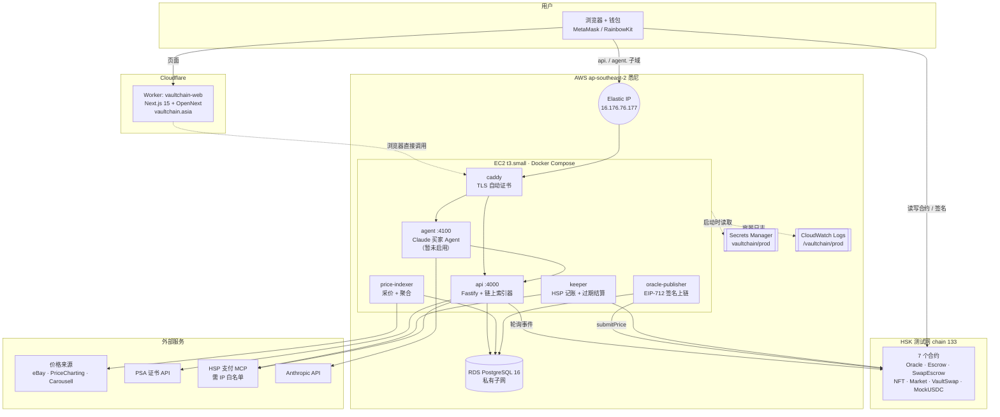
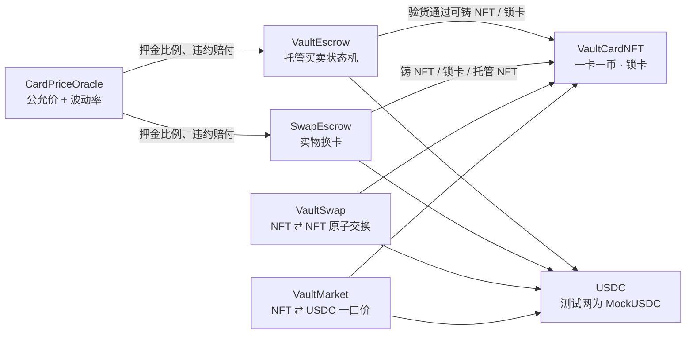
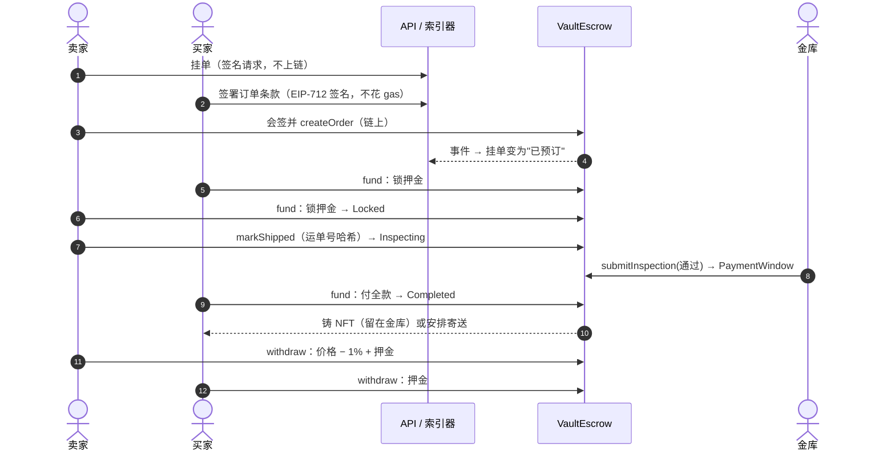
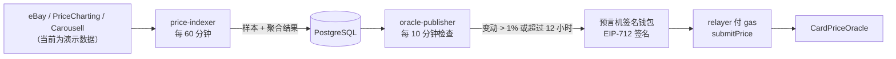
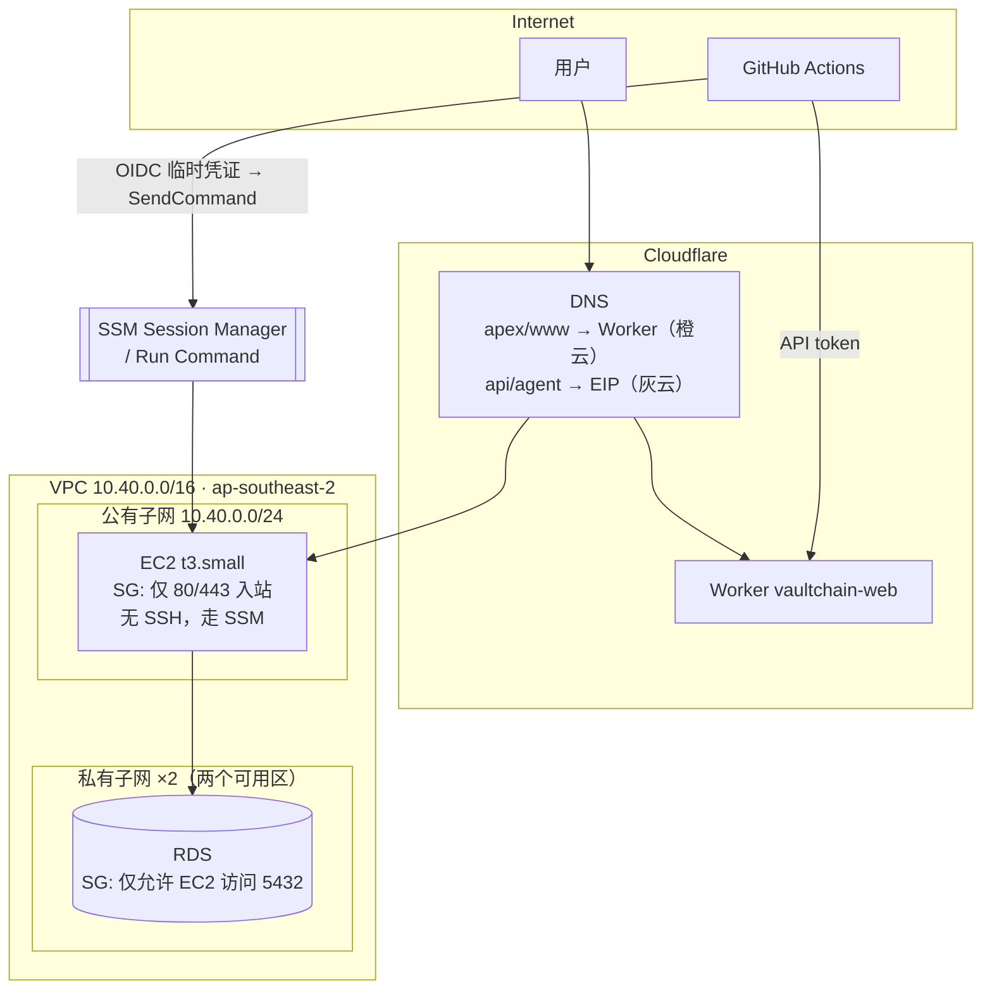
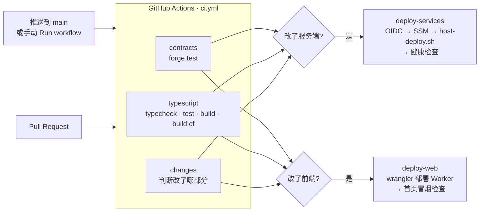

# VaultChain 系统架构（业务架构 + 运维架构）

> 更新：2026-11-28 · 适用环境：HSK 测试网（chain 133）
> 配套文档：操作步骤见 `docs/部署与运维手册.md`，剩余工作见 `docs/开发任务清单.md`。
> 下面的图用 Mermaid 写，GitHub 上会直接渲染成图。

---

## 1. 一句话

**评级卡（PSA / BGS / CGC）托管交易市场**：买卖双方各锁一笔按波动率计算的押金，卡寄到合作金库验货，验货结果和公允价格都签名上链，由智能合约结算；卡可以留在金库变成 NFT，随时转卖、换卡或赎回实物。

---

## 2. 整体架构

### 2.1 分层说明

| 层 | 组件 | 职责 | 代码位置 |
|---|---|---|---|
| 前端 | Next.js 15 + React 19、wagmi / viem / RainbowKit、Tailwind、lucide-react 图标 | 商城、下单、换卡、我的卡、金库后台；钱包签名和发交易都在浏览器完成 | `apps/web` |
| 边缘 | Cloudflare Workers（OpenNext 适配） | 托管前端；域名 `vaultchain.asia`、`www` | `apps/web/wrangler.jsonc` |
| API | Fastify 5 + Zod | 卡目录、挂单、出价、交换提案、报价、收货地址（加密）、HSP 收银台；**链上索引器**把合约事件同步进数据库 | `services/api` |
| 价格 | price-indexer → oracle-publisher | 多源采价 → 归一、去异常、时间加权中位数 → EIP-712 签名 → 写入预言机合约 | `services/price-indexer`、`services/oracle-publisher` |
| 结算辅助 | keeper | 把 HSP 付款记到托管合约；到期后触发结算 | `services/keeper` |
| AI | 买家 Agent（Claude 工具调用）+ 卖家 Agent（规则引擎） | 搜卡、比价、A2A 议价、生成订单草稿（**暂未启用**） | `services/agent` |
| 合约 | Solidity 0.8.28 · OpenZeppelin 5.4 · Foundry | 资金托管、状态机、NFT、价格 | `contracts/src` |
| 共享库 | `@vaultchain/shared`（ABI、EIP-712 类型、定价公式、合约地址）、`db`、`chain`、`hsp` | 前后端共用 | `packages/*` |

---

## 3. 智能合约

| 合约 | 地址（chain 133） |
|---|---|
| MockUSDC | `0xf1364bc13cc3834b3E8f0D243F7767a838F4cA46` |
| CardPriceOracle | `0x78ca4F8cE89AD5DF7E6F84b73B0E008F455ff2AB` |
| VaultCardNFT | `0x0C816C847973ec52109E3Ea04b27aE2806215c3D` |
| VaultEscrow | `0xf23a69D1594Bc6E2E6C0DF1Fb4f58ff075f2f446` |
| VaultMarket | `0x39806A0eb34A398b7404EBe24B6514524dC6Dc2f` |
| SwapEscrow | `0x2e7DD9eB7DEfe7534BF316581dE8088499D1a014` |
| VaultSwap | `0x397c41387462c18d2C0878421084D55976FF66FC` |

**关键规则**
- 押金（每方）= `clamp(10% + 2σ, 10%, 30%)` × 价格，σ 为 30 日波动率；押金按整分取整。
- 违约赔付 = `max(5% × 价格, 签约后的不利价格变动)`，以押金为上限。
- 一张实物卡同一时间只能在一笔订单或交换里（合约 `lockSlab`，重复下单报 `SlabBusy`）。
- 手续费：托管买卖 1%（卖方付），金库一口价 1%，NFT 原子交换每方 $5。
- 预言机拒绝过期、未来时间、单次跳变 > 30% 的价格（管理员可覆盖）。

**角色**

| 角色 | 持有者（测试网） |
|---|---|
| `DEFAULT_ADMIN_ROLE`、`ARBITER_ROLE`、`TREASURY_ROLE`、`VAULT_ROLE` | 部署钱包 `0x7723…aD92`（本机 keystore） |
| `ORACLE_SIGNER_ROLE` | 预言机签名钱包 `0x853C…b0A5` |
| `RELAYER_ROLE` | relayer `0xD439…06BD` |
| `VAULT_ROLE`、`MINTER_ROLE`（测试用） | 测试金库员 `0xdc83…CcF4` |
| `MINTER_ROLE`、`ESCROW_ROLE`（NFT） | VaultEscrow、SwapEscrow 合约 |

---

## 4. 核心业务流程

### 4.1 托管买卖（实物卡）

失败分支：任一方超时不付押金 → Cancelled；卖家不发货 → SellerDefault（买家获赔）；验货不通过或超时 → Disputed（仲裁）；买家不付尾款 → BuyerDefault（卖家获赔，卡退回或公司回购 BoughtOut）。

### 4.2 卡对卡交换

- **两张都在金库**：VaultSwap 一笔交易原子互换 NFT（+ 补差价），无押金无物流。
- **至少一张是实物**：SwapEscrow，双方锁押金（按两张卡中较高的价值和波动率），便宜一方加付差价；实物卡寄金库逐张验货，全部通过后各自拿到对方的卡（NFT 或寄出）。系统按公允价校验两边价值差不超过 10%。

### 4.3 价格上链

### 4.4 HSP 付款（已实现、待联调）

API 创建 HSP 订单 → 用户在 HSP 签名付款 → HSP Gateway 把 USDC 直接打到托管合约 → keeper 用 relayer 调合约记账，推进订单状态。HSP 只接受白名单 IP，所以所有调用 HSP 的服务都固定在 Elastic IP 后面。

---

## 5. 数据与密钥

| 数据 | 存在哪 | 说明 |
|---|---|---|
| 订单 / 交换 / 资产的真实状态 | **链上合约** | 唯一可信来源 |
| 挂单、出价、交换提案、价格样本、索引后的订单 | RDS PostgreSQL | API 启动时自动迁移表结构 |
| 收货地址 | RDS（AES-256-GCM 加密） | 密钥 `SHIPPING_ENC_KEY`；只有对应买家和金库管理员能看 |
| 服务密钥（签名私钥、relayer 私钥、内部 token、加密密钥） | Secrets Manager `vaultchain/prod` | 服务器启动 / 部署时读取，写进权限 600 的 `infra/.env` |
| 数据库密码 | RDS 自管 secret | 自动轮换不影响：每次部署重新读取 |
| 测试钱包私钥 | Secrets Manager `vaultchain/e2e` | 仅测试网 |
| 合约管理员私钥 | 负责人本机 Foundry keystore | 不在任何服务器上 |
| 合约地址 | `packages/shared/src/deployments.json`（提交在仓库） | 构建时写进前后端 |

---

## 6. 运维架构

### 6.1 部署拓扑

- **基础设施即代码**：全部 AWS 资源在 `infra/aws/vaultchain.yaml`（CloudFormation 栈 `vaultchain`），用 `infra/aws/deploy-stack.sh` 创建 / 更新。改之前先看 change set（手册 §5）。
- **服务器启动**：UserData 装 Docker、开 4 GB swap、克隆仓库，然后执行 `infra/aws/host-deploy.sh`。
- **账号限制**：组织 SCP 只放行悉尼；Free 计划只能用免费套餐机型、RDS 备份 1 天。

### 6.2 CI/CD 流水线

| 项 | 说明 |
|---|---|
| CI 触发 | 每次推送到 main、每个 PR、手动运行 |
| CD 触发 | 只在 main（推送或手动运行），且 **CI 两个任务都通过之后** |
| 按改动部署 | `services/`、`packages/`、`pnpm-lock.yaml`、`infra/docker*`、`infra/Caddyfile`、`infra/.env.example`、`infra/aws/host-deploy.sh` → 部署服务端；`apps/web/`、`packages/`、`pnpm-lock.yaml` → 部署前端；只改文档 → 不部署；手动运行 → 全部部署 |
| 服务端部署方式 | GitHub OIDC 换取 AWS 临时凭证（角色 `vaultchain-GitHubDeployRole-…`，只允许 main 分支，只能对这台 EC2 发 SSM 命令）→ `infra/aws/redeploy.sh` → 服务器拉 main、从 Secrets Manager 刷新配置、按顺序构建镜像、重启 → 检查 `https://api.vaultchain.asia/health` |
| 前端部署方式 | `pnpm --filter @vaultchain/web deploy:cf`，构建变量来自仓库 Variables；需要仓库 Secret `CLOUDFLARE_API_TOKEN`（**未配置时自动跳过并给出警告**） |
| 不会同时跑两个部署 | 每类部署有独立的 concurrency 组，排队执行 |
| 灰度 / 金丝雀 | **没有**。单台服务器、单个 Worker，部署即全量；服务端更新时会中断几秒。原因和以后的做法见 §7 |
| 回滚 | 服务端：`git revert` 推到 main 会自动重新部署；前端：Cloudflare 控制台 → Workers → `vaultchain-web` → Deployments 切回上一个版本 |

**仓库里的 CI/CD 配置**

| 类型 | 名字 | 值 / 用途 |
|---|---|---|
| Variable | `AWS_DEPLOY_ROLE_ARN` | GitHub 部署角色 ARN（CloudFormation 输出 `GitHubDeployRoleArn`） |
| Variable | `CLOUDFLARE_ACCOUNT_ID` | Cloudflare 账号 ID |
| Variable | `NEXT_PUBLIC_API_URL` / `NEXT_PUBLIC_AGENT_URL` / `NEXT_PUBLIC_CHAIN_ID` | 前端构建变量 |
| Variable | `NEXT_PUBLIC_ENABLE_TEST_FAUCET` | `true`，**上线主网前删除** |
| Variable | `NEXT_PUBLIC_WALLETCONNECT_PROJECT_ID` | 待配置 |
| Secret | `CLOUDFLARE_API_TOKEN` | **待负责人创建**（Cloudflare → My Profile → API Tokens → "Edit Cloudflare Workers" 模板），然后 `gh secret set CLOUDFLARE_API_TOKEN` |

### 6.3 可观测性

| 项 | 现状 |
|---|---|
| 日志 | 所有容器通过 awslogs 驱动写入 CloudWatch `/vaultchain/prod`，保留 30 天 |
| 健康检查 | `api` / `agent` 的 `/health`；CD 部署后自动检查 api |
| 回归测试 | `pnpm --filter @vaultchain/api e2e:testnet`（15 步，真实链上） |
| 告警 | **没有**（任务 T-12）：重点是 relayer 余额、`/health`、oracle-publisher 连续失败 |
| 前端 | Cloudflare Workers observability 已开启 |

### 6.4 安全边界

- 服务器只开 80/443；没有 SSH，运维走 SSM。
- 数据库在私有子网，只接受服务器安全组。
- 服务器角色只能读 `vaultchain/prod` 和数据库 secret、写日志、读写证据桶。
- GitHub 不保存 AWS 长期密钥（OIDC），部署角色只能对一台机器发命令。
- 链上：管理员私钥只在负责人本机；服务热钱包只放少量 gas；签名和付 gas 分离（签名钱包不发交易）。
- 仓库公开：任何私钥、密码、API key 不入库。

### 6.5 费用（2026-11 估算）

| 项 | 月费 |
|---|---|
| EC2 t3.small | ~$19 |
| RDS db.t4g.micro + 20 GB | ~$21 |
| 公网 IPv4 | ~$3.6 |
| Secrets Manager、日志、S3 | 几美元 |
| Cloudflare Workers | 免费额度内 |
| GitHub Actions | 公开仓库免费 |
| **合计** | **~$43**，从 Free 计划 $120 额度扣 |

---

## 7. 演进方向（未做）

| 方向 | 做法 | 代价 |
|---|---|---|
| 前端灰度 | Cloudflare Workers 按百分比发布新版本（gradual deployments） | 基本免费，改部署命令即可 |
| 服务端灰度 | 至少两台服务器 + ALB 按比例分流，或改造为 ECS / Lambda + CodeDeploy 金丝雀 | 突破 Free 计划：第二台机器、ALB 约 $20/月起；HSP 要固定出口 IP，Lambda 需 NAT 网关（约 $30+/月） |
| 高可用 | 多台服务器、RDS 多可用区、备份 7 天 | 需升级 AWS 付费计划 |
| 告警 | CloudWatch 指标过滤 + 告警 + 通知渠道 | 很低 |
| 主网 | 真实 USDC、Safe 多签管理员、去掉测试功能 | 见手册 §9 |
